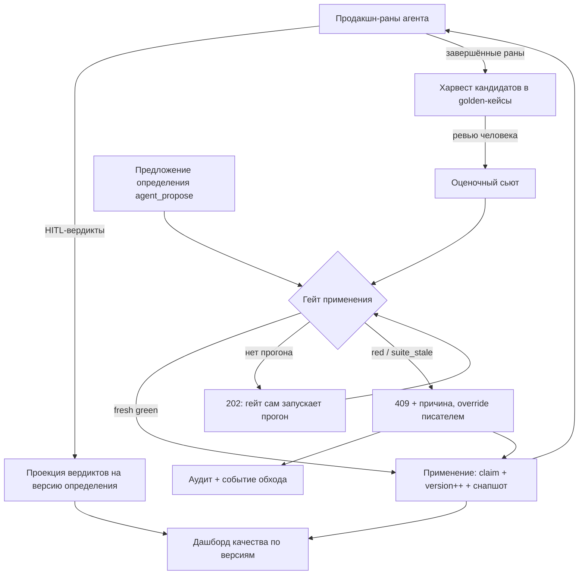

# Контур качества агентов (Quality Loop)

## 1. Цель

Сделать эволюцию агентов **проверяемой**, а не декларативной. Агенты в
Temporality развиваются через предложения определений (`agent_propose`,
docs/evaluable-agent.md): агент наблюдает собственное трение, предлагает
изменение промпта, человек применяет. Пока применение ничем не подтверждается,
кроме внимания человека, любой переход на новую версию определения — акт
веры: «кажется, станет лучше».

Контур качества замыкает эту петлю измеримым сигналом:

> **Применение предложения агента допускается только поверх свежего зелёного
> оценочного прогона на его базовой версии.**

Вокруг этого правила выстраивается остальное: откуда берутся оценочные кейсы
(из живого продакшна), чем проверяются открытые ответы (LLM-судья с
калибровкой), что происходит при обходе гейта (аудит, который невозможно
потерять), и как увидеть, стало ли реально лучше (дашборд качества по
версиям).

Документ описывает реализованный контур: HITL-вердикты как сигнал, сбор
golden-кейсов из прогонов, гейт на применении, судью с калибровкой и дашборд
качества.

---

## 2. Проблематика состояния до контура

* **Применение не проверяется.** Человек читает текст предложения и жмёт
  apply. Реакцию агента на типовые задачи после изменения никто не сравнивает
  с реакцией до него.
* **Сигналы исчезали.** Решения людей (`ask_human`, подтверждения операций)
  оставались в журнале, но не становились измеримым качеством: сколько
  предложений агента приняли, сколько исправили, сколько отвергли — по
  версиям определения этого не видно.
* **Golden-кейсы протухают незаметно.** Даже там, где оценочные прогоны были
  (living skills), ожидаемые ответы не пересматривались: дрейф мира и дрейф
  ожиданий маскировались под «агент деградирует» — или наоборот, старый
  эталон скрывал реальную деградацию.
* **Паттерны не покрывают открытые ответы.** Проверка «в ответе есть
  подстрока» работает для фактов и не работает там, где важна связность,
  полнота и отсутствие вредных советов.
* **Обход без следа.** Применить определение мимо любой проверки можно было
  бы одним флагом — и если бы аудит при этом падал, применение оставалось бы
  без журнала обхода (CWE-778).
* **Нет ответа на главный вопрос.** «Стало ли лучше после N версий?»
  требовало ручного сравнения прогонов.

---

## 3. Основные понятия

### 3.1. Evaluation Suite (оценочный сьют)

Список golden-кейсов, привязанный к агенту (не к версии — сьют один, версии
меняются). Кейс декларативен:

* `input` — задача для агента;
* `must_contain` / `must_not_contain` — ожидаемые и запрещённые подстроки;
* `check` — класс проверки: `patterns` (по умолчанию), `judge`,
  `patterns+judge` (паттерны необходимы, судья достаточен);
* `expected_output` — эталонный ответ (из принятого кандидата или руками);
* `held_out` — кейс вне гейта: виден в сьюте, но никогда не решает применение
  (страховка от «подгонки под гейт»);
* `stale_after` — дедлайн ревью эталона; по умолчанию 90 дней.

Сьют ограничен 16 кейсами — это потолок осмысленного ревью, а не техническое
ограничение.

### 3.2. Evaluation Run (оценочный прогон)

Прогон сьюта против **зафиксированной версии определения**: каждый кейс —
отдельный вызов модели, заземлённый скомпилированным промптом именно этой
версии. Прогон записывается с привязкой к версии, поэтому сравниваются
определения, а не дрейфующий «текущий» промпт.

Вердикт прогона: `pass` / `fail` / `error` (`error` — никогда не `pass`:
ошибка судьи или модели не считается успехом). Триггеры прогона: `manual`,
`gate` (запущен гейтом применения), `schedule` (регулярный запуск планировщиком
по настраиваемому интервалу, см. §8.1).

### 3.3. Eval Gate (гейт применения)

Состояние, вычисляемое на момент применения предложения:

* **fresh green** — зелёный прогон на базовой версии, не старше окна
  свежести (3 рабочих дня; выходные не расходуют окно);
* **red** — красный прогон или judge-degraded зелёный;
* **running** — гейт уже запустил прогон, применение ждёт его;
* **base_version_stale** — база предложения отстала от агента;
* **suite_stale** — в сьюте протухшие по `stale_after` кейсы.

### 3.4. HITL-вердикт

Решение человека, спроецированное в типизированный сигнал и привязанное к
версии определения, жившей на момент вопроса: `accepted` (согласился),
`corrected` (исправил ответ), `rejected` (отверг). Источники: ответ на
`ask_human`, решение по операции, ручная сверка операции. Классификация
исхода прогона по вердиктам детерминирована: отвергнутый вердикт
дисквалифицирует прогон как кандидата в golden.

### 3.5. Кандидат в golden-кейсы

Завершённый продакшн-ран, из которого может вырасти оценочный кейс:
`input` — промпт задачи, `expected_output` — ответ прогона (источник
`succeeded_run`) или исправление человека (источник `human_corrected`).
Кандидат проходит ревью человеком; отклонённые удаляются через 90 дней.

### 3.6. LLM-судья

Модель инсталляции (`EVAL_JUDGE_MODEL`), оценивающая открытые ответы по
заданной инструкции с порогом 0–100. Судья допускается до гейта только после
калибровки: соглашение с историческими вердиктами не ниже **0.7**, иначе
судья помечается `judge-degraded`, и его прогоны гейт отвергает как красные.

### 3.7. Quality Report

Агрегат по каждой версии определения: прогоны, исходы HITL-вердиктов,
лучший и последний прогон сьюта (с вердиктом и соглашением судьи),
количество golden и время до подтверждённого улучшения. Версия без данных
честно отвечает `has_data=false` — никаких фейковых нулей.

---

## 4. Петля качества целиком

Петля читается так: продакшн создаёт и кейсы, и вердикты; сьют с вердиктами
питает гейт; гейт охраняет применение; применение меняет агента; дашборд
показывает, стало ли лучше — и цикл повторяется. Ни одна стрелка не ведёт
мимо наблюдаемости: обход гейта (`gate:false`, override) оставляет аудит и
событие.

---

## 5. HITL-вердикты как оценочный сигнал

Решения людей — самый честный сигнал качества, но до контура они жили в
журнале и умирали там. Теперь:

* **Три источника** проецируются одинаково: ответ на `ask_human` (человек
  выбрал вариант или ответил своим), решение по операции (подтвердил /
  отверг побочный эффект), ручная сверка операции.
* **Привязка к версии определения.** Вердикт относится к версии, которая была
  активна в момент вопроса, а не в момент чтения отчёта — иначе улучшения
  credited не той версии.
* **Классификация исхода прогона детерминирована** (`ClassifyRunOutcome`):
  статус прогона + набор вердиктов → исход. Отвергнутый вердикт — прогон
  исключается из кандидатов в golden.

---

## 6. Сбор golden-кейсов из продакшна

Фоновая задача ядра (тик 5 минут) превращает законченные раны в кандидатов:

1. **Обновление терминальных статусов** — строки прогонов в workspace
   остаются «started», пока их никто не спросит; задача подтягивает статус и
   ответ из Temporal (те же данные, что отдаёт ручной GET рана).
2. **Харвест** — в кандидаты попадают только:
   * терминальные раны (completed/succeeded/failed/turn_limit/time_limit/
     token_limit/budget_limit);
   * без отвергнутых HITL-вердиктов;
   * без несверованных операций (неопределённый эффект — не эталон);
   * с ответом не длиннее 8192 символов;
   * в окне 90 дней и после «успокоения» журнала (2 минуты).
     Источник эталона: исправление человека (`human_corrected`) приоритетнее
     ответа успешного прогона (`succeeded_run`).
3. **Ревью-очередь** — человек принимает или отклоняет; принятое становится
   кейсом сьюта с `expected_output`.
4. **Защита от загрязнения** — не более 70 % принятых golden агента может
   приходить из одного проекта (иначе сьют выучивает специфику одного
   клиента).
5. **Уборка** — отклонённые кандидаты удаляются через 90 дней; повторный
   сбор отклонённого исключён.

События: `eval.case_candidate.created`, `eval.case_candidate.decided`.
Кандидаты несут производственный текст, поэтому ревью — зона writer/owner.

---

## 7. Гейт на применении предложения

### 7.1. Базовое правило

`POST /v1/workspace/agents/{id}/proposals/{pid}/apply` требует свежий зелёный
прогон сьюта на **базовой версии** предложения (той, на которой предложение
основано). Логика:

| Состояние                   | Ответ                                  | Что происходит                               |
| --------------------------- | -------------------------------------- | -------------------------------------------- |
| База отстала                | `409 base_version_stale`               | Предложение нужно перебазировать             |
| Протухший golden            | `409 suite_stale` + список кейсов      | Ревью эталонов или override                  |
| Сьют не может решить гейт   | `409 suite_not_ready` + cause          | Пусто / меньше 3 кейсов / judge без модели   |
| Нет прогона                 | `202` + `evaluation_run_id`            | Сервер сам запускает прогон (`trigger=gate`) |
| Повторный apply при прогоне | тот же `202`, тот же run               | Идемпотентность: второй прогон не стартует   |
| Красный прогон              | `409 gate_blocked` + проваленные кейсы | Override писателем с justification           |
| Зелёный (свежий)            | применение                             | Транзакционный apply                         |

Причины `suite_not_ready` (`suite_empty`, `suite_too_small`,
`judge_not_configured`) — те, что вердикт-алгоритм в любом случае превратил
бы в `error`. Отказ до запуска прогона — осознанный: детерминированная
неисправимость сьюта иначе превращается в цикл обречённых gate-прогонов
(`202` → error-ран → «нет прогона» → новый `202`). Пути применения:
дополнить сьют до трёх кейсов, настроить судью, override с обоснованием
или `gate:false` — все обходы по-прежнему аудируются.

### 7.2. Свежесть

Зелёный прогон действителен **3 рабочих дня** (`EVAL_GATE_FRESHNESS_WORKDAYS`,
0 — без ограничения). Суббота и воскресенье не расходуют окно: решение,
принятое в пятницу, валидно в среду. Ручка существует, чтобы подстроиться под
реальную частоту применений.

### 7.3. Транзакционность применения

Применение — одна транзакция: claim предложения + инкремент версии агента +
неизменяемый снапшот версии. Частичное применение невозможно.

### 7.4. Обход и его цена

`gate:false` пропускает проверку (право писателя), но обход не бывает
ни тихим, ни бесплатным:

* **F-1 (порядок).** Событие `agent.evaluation.gate.skipped` эмитится
  только после фактического применения: неудачное применение не оставляет
  следа несуществовавшего обхода.
* **F-2 (fail-closed аудит).** Аудит-запись обхода едет **в транзакции
  применения** (`Store.ApplyAgentProposalAudited`): неудачный INSERT в
  `access_audit_log` откатывает применение целиком и отвечает
  `503 audit_write_failed`. Применение без записи об обходе невозможно
  физически (CWE-778).
* **Override красного** требует `justification`, пишет аудит и событие
  `agent.evaluation.gate.overridden`; доля обходов — метрика здоровья петли.

### 7.5. Мёртвые прогоны

Прогон гейта, зависший в «running» дольше 30 минут (умерло ядро, отвалился
путь записи), переводится в `error` следующим apply — частичные прогоны
никогда не гейтят, вечного `202` не бывает.

---

## 8. LLM-судья с калибровкой

### 8.1. Зачем

Паттерны отвечают на «есть ли подстрока», но не на «полный ли это ответ,
без ли вредного совета и по делу ли». Класс `judge`/`patterns+judge` поручает
оценку модели-судье.

### 8.2. Контракт судьи

* **Одна модель на инсталляцию** (`EVAL_JUDGE_MODEL`), валидируется против
  настроенных провайдеров; не настроена — судейские кейсы в PUT сьюта
  отвергаются (`422 judge_not_configured`).
* **Калибровка до допуска.** Судья прогоняется по историческим вердиктам
  агента; соглашение ниже 0.7 — статус `judge-degraded`, и гейт отвергает
  такие прогоны как красные (`cause=judge_degraded`).
* **Ошибки судьи — ошибки прогона.** Таймаут, битый JSON, ошибка модели —
  `error`, никогда не `pass`.
* **Маркер самосмещения.** Если судья та же модель, что тестируемый агент
  (`judge_same_model`), это видно в отчёте — слепая зона «модель хвалит
  себя» не прячется.
* **Судья не расширяет права.** Он только оценивает ответы; применение и
  обход — по-прежнему человеческие решения.

### 8.1. Конфигурация судьи и расписания

`GET/PUT /v1/workspace/evaluation-judge` — модель судьи. PUT требует права
оператора и валидирует модель по спискам провайдеров (422 на неизвестную);
пустая модель — явное «выключено». Приоритет: настройка в интерфейсе бьёт
env `EVAL_JUDGE_MODEL`; существующая строка настройки (даже пустая) —
осознанный выбор оператора, env используется только пока строки нет.

`GET/PUT /v1/workspace/quality-schedule` — интервал регулярных прогонов
(`interval_hours`, 0 = выключено; GET доступен читателю, PUT — оператору).
Планировщик перечитывает настройку каждую минуту (правки без рестарта),
якорит следующий прогон на последний `trigger=schedule` прогон и гоняет
сьюты последовательно (таймаут 10 минут на агента) по текущей версии
определения. Обе настройки живут в UI на странице агентов.

---

## 9. Дашборд качества

`GET /v1/workspace/agents/{id}/quality` (writer/owner) — таблица по версиям
определения:

* прогоны и исходы HITL-вердиктов (accepted / corrected / rejected);
* лучший и последний прогон сьюта: pass rate, вердикт, соглашение судьи;
* количество golden и **время до подтверждённого улучшения** — сколько
  прошло от применения версии до первого зелёного прогона с улучшением;
* версия без данных — `has_data=false`, метрики `null`.

`GET /v1/workspace/agents/{id}/versions/diff?from=&to=` (reader) — структурный
diff двух снапшотов (что добавлено/удалено/изменено в определении) плюс diff
скомпилированных промптов: «что именно изменится в голове агента».

---

## 10. Наблюдаемость

События контура (durable outbox, лучшие усилия — кроме F-2):

| Событие                             | Когда                                        |
| ----------------------------------- | -------------------------------------------- |
| `eval.case_candidate.created`       | Ран захарвестен в кандидата                  |
| `eval.case_candidate.decided`       | Кандидат принят/отклонён                     |
| `agent.evaluation.gate.passed`      | Гейт пропустил применение                    |
| `agent.evaluation.gate.blocked`     | Красный прогон заблокировал применение       |
| `agent.evaluation.gate.overridden`  | Писатель провёл красный с justification      |
| `agent.evaluation.gate.skipped`     | `gate:false` (после фактического применения) |
| `agent.evaluation.judge.calibrated` | Калибровка судьи завершена                   |
| `agent.evaluation.judge.configured` | Оператор изменил модель судьи                |
| `agent.evaluation.schedule.changed` | Оператор изменил интервал расписания         |
| `agent.quality.dashboard_viewed`    | Кто-то открыл дашборд качества               |

Аудит (`access_audit_log`): override красного, `gate:false` — транзакционно.

---

## 11. Роли и приватность

* Ревью кандидатов и дашборд `/quality` — writer/owner: там производственный
  текст.
* Сьюты, прогоны, версии, диффы — reader.
* Все обходы — право писателя, ниже — отказ до чтения тела запроса.

---

## 12. Метрики здоровья петли

* **Override rate < 5 %** — если писатели постоянно проводят красное, гейт
  превратился в ритуал.
* **Доля judge-degraded прогонов** — здорова ли калибровка.
* **Свежесть гейтов** — как долго зелёные живут до применения.
* **Доля версий с `has_data=true`** — покрывает ли петля реальную эволюцию.
* **Протухшие кейсы** — сколько golden ждут ревью.

---

## 13. Что сознательно не делаем

* **Не гоняем сьюты на каждый чих.** Прогон — отдельные вызовы модели; его
  запускают гейт, человек или расписание, не каждое движение агента.
* **Не доверяем судье окончательно.** Ошибка судья-степа = ошибка прогона;
  degraded-судья = красный прогон; самосмещение маркируется.
* **Не растим сьюты бесконечно.** 16 кейсов и 70 %-й потолок доли проекта —
  границы осмысленного ревью.
* **Не делаем авто-применение по зелёному.** Зелёный гейт открывает
  применение человеку, а не заменяет его.
* **Held-out кейсы не решают гейт** — это контрольная группа против
  оптимизации под тест.

---

## 14. Критерии готовности

Реализовано и покрыто тестами:

* проекция HITL-вердиктов и классификация исходов прогонов;
* харвест кандидатов: терминальность, дисквалификация по отвергнутым
  вердиктам и несверованным операциям, приоритет исправления человека, окно и
  уборка;
* гейт: все ветки таблицы §7.1, идемпотентный 202, свежесть в рабочих днях,
  перевод мёртвых прогонов в error;
* F-1/F-2: порядок журналирования, транзакционный аудит `gate:false`
  (откат и 503 при падении INSERT);
* судья: калибровка, порог 0.7, degraded-отказ, judge_same_model,
  валидация конфигурации при PUT сьюта;
* дашборд: агрегаты по версиям, `has_data=false`, диффы определений и
  промптов.

---

## 15. Открытые вопросы

* **Авто-приём кандидатов.** Пока каждый golden проходит человека; при росте
  потока понадобится политика доверия (например, авто-приём повторяющихся
  идентичных источников с высокой долей accepted).
* **Семантическая дедупликация golden.** Кейсы могут дублировать друг друга
  по смыслу; детерминированной дедупликации нет.
* **Расширение проверок.** Скриптовые и траекторные проверки (последовательность
  вызовов инструментов) — следующая ступень после паттернов и судьи.

---

## 16. Архитектурные ограничения

* Вердикты и агрегаты никогда не дублируют логику гейта: дашборд читает
  проекции, гейт вычисляет состояние сам, но из тех же примитивов.
* Оценочный прогон всегда заземлён снапшотом версии: «проверить текущее
  состояние агента» без зафиксированной версии не существует.
* Никакой путь не пишет в аудит после факта без транзакционной связи с
  применением, если этот аудит — единственный след обхода.
* Судья — опция установки, а не требование: контур работает и на одних
  паттернах, деградируя честно (`judge_not_configured`).
