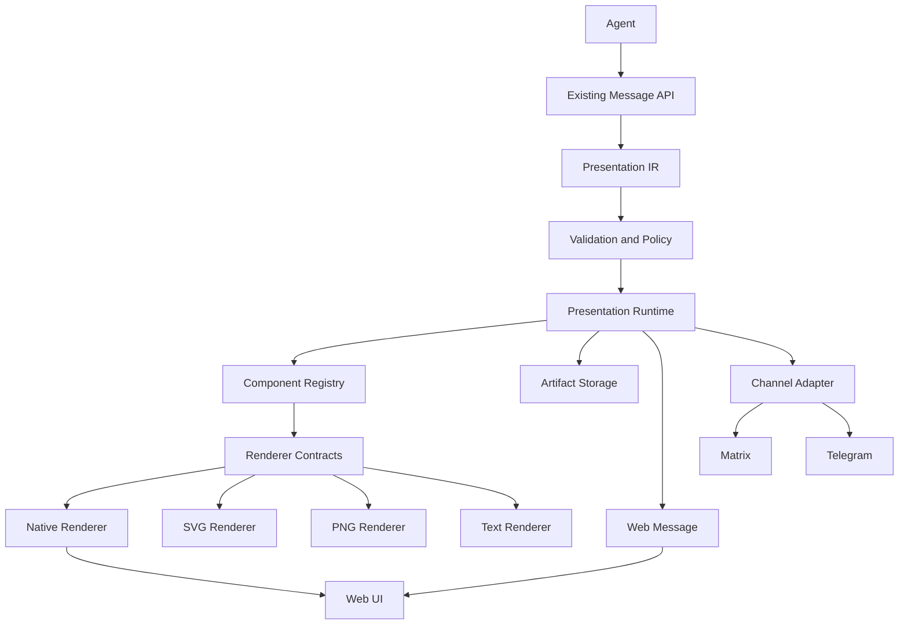

# Техническое задание: Presentation Engine для Temporality

**Компонент:** Presentation Engine  
**Продукт:** Temporality  
**Тип:** Подсистема Agent Runtime / Communication  
**Приоритет:** P0  
**Статус:** Ready for implementation

---

# 1. Цель проекта

Разработать универсальную подсистему визуальной и интерактивной коммуникации между агентами Temporality и пользователями.

В настоящее время взаимодействие с агентами преимущественно осуществляется посредством текстовых сообщений. Это ограничивает эффективность коммуникации: результаты анализа, сложные взаимосвязи, планы, сравнения и промежуточные результаты приходится описывать длинными текстовыми сообщениями.

Presentation Engine должен предоставить агентам универсальные средства выразительности, позволяющие самостоятельно выбирать оптимальную форму представления информации.

Подсистема должна поддерживать:

- Форматированный текст и Markdown.
- Таблицы и структурированные карточки.
- Графики и диаграммы.
- Блок-схемы и графы взаимосвязей.
- Timeline, roadmap и Gantt.
- Изображения, иллюстрации и скриншоты.
- Интерактивные формы и элементы управления.
- Составные визуальные представления.
- Статические визуальные представления для каналов, не поддерживающих интерактивный UI.

## 1.1. Основной принцип

**Агент должен не просто формировать текстовый ответ, а выбирать наиболее подходящий способ представления результата своей работы.**

Presentation Engine обеспечивает единый декларативный контракт между агентами и пользовательскими интерфейсами.

При этом:

- Агент определяет содержание и семантику представления.
- Runtime контролирует доступность возможностей и допустимые действия.
- Presentation IR описывает структуру содержимого.
- Web Renderer обеспечивает интерактивное отображение.
- Server-side Channel Adapters адаптируют представления к внешним каналам.
- Artifact Storage обеспечивает хранение файлов и бинарных артефактов.

## 1.2. Целевые результаты

1. Сокращение избыточных текстовых ответов.
2. Повышение понятности результатов агентной работы.
3. Поддержка визуальной аналитики.
4. Возможность интерактивного взаимодействия с результатами.
5. Единый механизм представления для всех типов агентов.
6. Независимость от конкретной LLM и её возможностей.
7. Независимость семантического описания от конкретного UI-фреймворка.
8. Возможность добавления новых компонентов без изменения Agent Runtime.
9. Единообразное представление информации в разных каналах коммуникации.

# 2. Архитектурные принципы

При реализации необходимо придерживаться следующих принципов.

### 2.1. Расширение существующего механизма сообщений

Presentation Engine не должен создавать параллельную систему коммуникации.

Необходимо расширить существующий формат сообщений Temporality, предусмотрев поддержку структурированного содержимого и вложенных визуальных компонентов.

Обычные текстовые сообщения должны продолжать работать без изменений.

### 2.2. Единый декларативный формат

Все визуальные компоненты описываются через Presentation IR.

IR не должен зависеть от:
- React или другого UI-фреймворка.
- Mermaid или другой библиотеки диаграмм.
- Конкретной модели LLM.
- Конкретного канала коммуникации.

### 2.3. Разделение серверной и клиентской ответственности

Web Renderer располагается на стороне клиентского приложения.

Серверная часть отвечает за:
- Валидацию Presentation IR.
- Проверку политик.
- Управление жизненным циклом представлений.
- Адаптацию к каналам коммуникации.
- Генерацию статических представлений SVG и PNG.
- Управление артефактами.
- Обработку пользовательских действий.

### 2.4. Универсальность

Все агенты используют единый Presentation Engine.

Не допускается создание отдельных механизмов визуализации для Coder, Reviewer, QA, Researcher, Delivery Manager и других ролей.

# 3. Общая архитектура



## 3.1. Основные компоненты

| Компонент | Ответственность |
|---|---|
| Presentation IR | Декларативное описание содержимого |
| Presentation API | Интерфейс создания представлений агентами |
| Validation & Policy | Проверка структуры и безопасности |
| Presentation Runtime | Управление жизненным циклом |
| Component Registry | Реестр типов компонентов |
| Web Renderer | Интерактивное отображение |
| Static Renderer | Генерация SVG и PNG |
| Text Renderer | Текстовое представление |
| Channel Adapter | Адаптация для каналов |
| Interaction Handler | Обработка действий пользователей |
| Artifact Storage | Хранение бинарных артефактов |

# 4. Presentation IR

## 4.1. Общие требования

Presentation IR — промежуточное декларативное представление содержимого сообщения.

Базовый формат — JSON.

Требования:
- Машиночитаемость.
- Версионирование.
- Расширяемость.
- Формальная схема валидации.
- Поддержка вложенных компонентов.
- Независимость от renderer.
- Безопасная обработка недоверенного содержимого.
- Возможность частичного обновления представлений.

## 4.2. Структура

Пример:

```json
{
  "version": "1.0",
  "type": "presentation",
  "id": "presentation-123",
  "title": "Test execution report",
  "content": [
    {
      "type": "text",
      "content": "Тестирование завершено."
    },
    {
      "type": "kpi",
      "items": [
        {
          "label": "Passed",
          "value": 942,
          "status": "success"
        },
        {
          "label": "Failed",
          "value": 31,
          "status": "danger"
        }
      ]
    },
    {
      "type": "chart",
      "chartType": "pie",
      "data": {
        "labels": ["Passed", "Failed", "Skipped"],
        "values": [942, 31, 27]
      }
    }
  ]
}
```

Это иллюстрация структуры. Окончательная JSON Schema определяется в ходе реализации.

## 4.3. Свойства компонентов

Каждый компонент должен поддерживать применимые к нему свойства:

- `type` — тип компонента.
- `id` — уникальный идентификатор.
- `content` — содержимое.
- `data` — структурированные данные.
- `props` — параметры отображения.
- `actions` — разрешённые интерактивные действия.

Не следует требовать наличия всех полей у каждого типа компонента.

## 4.4. Композиция

IR должен поддерживать составные представления.

Например, карточка может содержать:
- Заголовок.
- Текст.
- Изображение.
- KPI.
- Таблицу.
- Список.
- Ссылки.
- Кнопки действий.

Необходимо предусмотреть ограничения глубины вложенности, размера документа и количества компонентов.

# 5. Component Registry

Необходимо реализовать централизованный реестр визуальных компонентов.

Для каждого компонента регистрируются:

- Уникальный тип.
- Версия.
- JSON Schema.
- Native Renderer.
- SVG Renderer.
- PNG Renderer.
- Text Renderer.
- Поддерживаемые свойства.
- Поддерживаемые действия.
- Ограничения.
- Возможности fallback.

Реестр должен позволять подключать новые компоненты без модификации основного Agent Runtime.

Отсутствие реализации одного из обязательных renderer'ов должно обнаруживаться при регистрации компонента или прохождении тестов.

# 6. Каталог компонентов

## 6.1. Rich Text

| Тип | Назначение |
|---|---|
| text | Обычный текст |
| markdown | Форматированный Markdown |
| heading | Заголовки |
| paragraph | Абзацы |
| list | Списки |
| quote | Цитаты |
| code | Блоки кода |
| math | Математические формулы |
| link | Ссылки |
| badge | Статусные метки |
| icon | Иконки |
| divider | Разделители |

Markdown должен поддерживаться как базовый способ текстовой коммуникации.

## 6.2. Structured Data

| Тип | Назначение |
|---|---|
| table | Таблицы |
| card | Карточки |
| card-grid | Сетка карточек |
| comparison | Сравнение вариантов |
| key-value | Пары ключ-значение |
| kpi | Ключевые показатели |
| progress | Индикаторы прогресса |
| status | Статусы |
| alert | Предупреждения |
| accordion | Раскрываемые блоки |

Таблицы должны поддерживать:
- Заголовки.
- Типизацию значений.
- Выравнивание.
- Ссылки и действия в ячейках.
- Адаптивное представление.
- Сортировку при наличии соответствующей интерактивности.

## 6.3. Data Visualization

| Тип | Назначение |
|---|---|
| line-chart | Линейные графики |
| bar-chart | Столбчатые диаграммы |
| pie-chart | Круговые диаграммы |
| area-chart | Диаграммы областей |
| scatter-chart | Диаграммы рассеяния |
| heatmap | Тепловые карты |
| histogram | Гистограммы |
| gauge | Индикаторы значений |
| timeline-chart | Временные ряды |

Требования:
- Исходные данные передаются в структурированном виде.
- Поддерживаются названия осей и легенды.
- Поддерживаются единицы измерения.
- Поддерживаются подсказки и отображение значений.
- Обеспечивается адаптивная ширина.
- Обрабатываются нулевые и отрицательные значения.
- Для больших наборов данных предусмотрены ограничения.
- Визуализация не должна искажать исходные данные.

## 6.4. Diagrams

| Тип | Назначение |
|---|---|
| flowchart | Блок-схемы |
| sequence-diagram | Диаграммы последовательности |
| class-diagram | Диаграммы классов |
| er-diagram | ER-диаграммы |
| state-diagram | Диаграммы состояний |
| dependency-graph | Граф зависимостей |
| architecture-diagram | Архитектурные схемы |
| mindmap | Интеллект-карты |
| network-graph | Графы взаимосвязей |

Для первой реализации допустимо использовать существующие движки визуализации, включая Mermaid.

При этом IR не должен быть привязан к конкретному движку.

Для графов необходимо предусмотреть:
- Узлы.
- Направленные и ненаправленные связи.
- Типы узлов.
- Метки связей.
- Группировку.
- Выделение узлов.
- Переходы к связанным сущностям Temporality.

## 6.5. Planning & Timeline

| Тип | Назначение |
|---|---|
| timeline | Хронология событий |
| gantt | Диаграмма Ганта |
| roadmap | Дорожная карта |
| calendar | Календарь |
| milestone | Контрольные точки |
| dependency-map | Карта зависимостей |

Данные должны поддерживать временные интервалы, статусы, исполнителей и зависимости.

Для отображения существующих задач и проектов необходимо использовать ссылки на существующие сущности Temporality, не создавая дублирующие модели.

## 6.6. Media

| Тип | Назначение |
|---|---|
| image | Изображения |
| image-gallery | Галерея |
| video | Видео |
| audio | Аудиофайлы |
| screenshot | Скриншоты |
| file | Файловые вложения |
| generated-image | Сгенерированные изображения |

Источники:
- Артефакты агентов.
- Artifact Storage.
- Разрешённые внешние источники.
- Сервисы генерации изображений.
- Инструменты браузерной автоматизации и тестирования.

Генерация изображений не входит в обязательную ответственность Presentation Engine. Engine должен обеспечивать стандартизированное включение результатов генерации.

## 6.7. Interactive Components

| Тип | Назначение |
|---|---|
| button | Кнопка действия |
| form | Форма |
| input | Текстовый ввод |
| textarea | Многострочный ввод |
| checkbox | Флажок |
| radio | Выбор одного значения |
| select | Выпадающий список |
| tabs | Переключение представлений |
| filter | Фильтрация |
| date-picker | Выбор даты |
| slider | Числовой выбор |

Интерактивные компоненты должны быть декларативными. Произвольный код, переданный агентом, не исполняется.

# 7. Multi-format Rendering Contract

Это один из ключевых архитектурных контрактов Presentation Engine.

**Каждый визуализатор обязан уметь формировать интерактивное представление для Web и статические представления для внешних каналов.**

## 7.1. Обязательные форматы

| Формат | Назначение |
|---|---|
| Native UI | Интерактивное отображение в Web |
| SVG | Статическое векторное изображение для Matrix |
| PNG | Растровое изображение для Telegram |
| Text | Текстовый fallback |

## 7.2. Контракт визуализатора

Каждый визуализатор должен реализовывать следующие операции:

```typescript
interface Visualizer {
  render(
    component: PresentationComponent,
    context: RenderContext
  ): NativeView;

  renderSvg(
    component: PresentationComponent,
    context: RenderContext
  ): Promise<SVGArtifact>;

  renderPng(
    component: PresentationComponent,
    context: RenderContext
  ): Promise<PNGArtifact>;

  renderText(
    component: PresentationComponent,
    context: RenderContext
  ): string;
}
```

Интерфейс приведён концептуально. Конкретная реализация определяется используемым технологическим стеком.

## 7.3. Единый источник данных

Все renderer'ы должны получать одинаковый исходный компонент и данные.

Запрещается:
- Повторно обращаться к LLM для генерации статической версии.
- Создавать отдельные наборы данных для разных каналов.
- Изменять значения при экспорте.
- Терять подписи, единицы измерения и существенные элементы легенды.

Допускается адаптация геометрии, масштаба, компоновки и типографики под конкретный формат.

## 7.4. Требования к SVG

SVG должен:
- Быть автономным.
- Не зависеть от внешних CSS и ресурсов.
- Содержать все необходимые элементы изображения.
- Корректно отображаться в распространённых SVG-совместимых клиентах.
- Не содержать исполняемого JavaScript.
- Проходить безопасную обработку перед отправкой.
- Иметь корректные размеры и viewBox.

Для Matrix SVG следует передавать как отдельный файловый или графический артефакт в зависимости от возможностей клиента. Нельзя полагаться на inline SVG внутри сообщения.

Если конкретный клиент Matrix не отображает SVG, используется PNG fallback.

## 7.5. Требования к PNG

PNG должен:
- Иметь достаточное разрешение для читаемого отображения.
- Поддерживать адаптивный выбор размеров.
- Не содержать обрезанных элементов.
- Сохранять подписи и легенды.
- Не искажать данные.
- Оптимизироваться по размеру файла.

Для Telegram PNG передаётся как обычное изображение.

## 7.6. Text Fallback

Текстовый fallback должен передавать основную смысловую информацию визуализации.

Например, вместо графика без возможности отображения пользователь должен получить:
- Заголовок.
- Основные значения.
- Ключевые выводы.
- Краткое описание взаимосвязей.

## 7.7. Проверка соответствия

Для каждого визуализатора обязательны тесты:
- Соответствие данных во всех форматах.
- Наличие подписей.
- Наличие легенды, если она предусмотрена.
- Корректность размеров.
- Отсутствие обрезанного содержимого.
- Корректное отображение кириллицы.
- Корректная работа на светлой и тёмной темах там, где это применимо.

Все четыре формата являются частью Definition of Done нового визуализатора.

# 8. Web Renderer

## 8.1. Общие требования

Web Renderer реализуется на стороне клиентского приложения.

Рекомендуется использовать существующий UI-стек Temporality и его компонентную архитектуру.

Renderer должен:
- Поддерживать все компоненты MVP.
- Использовать общую дизайн-систему.
- Поддерживать desktop и mobile.
- Обрабатывать отсутствующие и некорректные данные.
- Показывать понятные ошибки визуализации.
- Поддерживать темы оформления.
- Обеспечивать accessibility.
- Не исполнять произвольный код из IR.

## 8.2. Design System

Все компоненты должны использовать единые:
- Цветовые токены.
- Типографику.
- Размеры.
- Отступы.
- Радиусы.
- Иконки.
- Состояния элементов.
- Адаптивные правила.

Агенты не должны самостоятельно задавать CSS, цвета и геометрию компонентов.

Оформление контролируется клиентским renderer'ом.

# 9. Channel Adapters

## 9.1. Общие требования

Серверная часть должна адаптировать представления к возможностям целевого канала.

Первоначально необходимо поддержать:

- Web UI.
- Matrix.
- Telegram.

## 9.2. Capability Negotiation

Каждый канал объявляет список поддерживаемых возможностей.

Пример:

```json
{
  "channel": "matrix",
  "capabilities": {
    "markdown": true,
    "tables": false,
    "images": true,
    "charts": false,
    "diagrams": false,
    "interactive_forms": false,
    "buttons": true,
    "files": true
  }
}
```

Это пример конфигурации, а не утверждение о возможностях всех клиентов Matrix.

Фактические capabilities должны определяться конкретным адаптером и, где необходимо, клиентом.

## 9.3. Стратегия адаптации

| Канал | Представление |
|---|---|
| Web | Native UI |
| Matrix | SVG |
| Matrix fallback | PNG |
| Telegram | PNG |
| Telegram fallback | Text / Markdown |
| Прочие каналы | По capabilities |

Для Matrix необходимо учитывать, что поддержка SVG зависит от конкретного клиента. Адаптер должен иметь возможность переключиться на PNG.

Для Telegram использовать PNG как основной формат визуализаций, учитывая ограничения платформы на размеры и типы вложений.

## 9.4. Fallback

Если канал не поддерживает компонент, используется следующая стратегия:

1. Нативное представление, если поддерживается.
2. SVG, если поддерживается каналом и клиентом.
3. PNG.
4. Текстовое представление.

Порядок должен учитывать capabilities и особенности канала.

Fallback не должен приводить к потере критически важной информации.

Если визуальное представление невозможно сформировать, система должна отправить текстовое описание и сообщить об ограничении.

# 10. Agent Presentation API

## 10.1. Общие требования

Агент должен иметь возможность создавать представления через существующий механизм сообщений.

Необходимо поддержать:

1. Формирование представления непосредственно в составе ответа.
2. Создание отдельного представления с последующей отправкой.
3. Обновление ранее созданного представления.
4. Добавление артефактов.
5. Получение информации о возможностях канала.

Не следует заставлять агента вызывать отдельный инструмент для каждой простой таблицы, карточки или графика.

Простые компоненты должны быть доступны непосредственно через декларативный формат ответа.

## 10.2. Операции

| Операция | Назначение |
|---|---|
| present | Отправить представление |
| create_presentation | Создать представление |
| update_presentation | Обновить представление |
| attach_artifact | Добавить артефакт |
| get_capabilities | Получить возможности канала |
| get_presentation | Получить существующее представление |

Конкретная реализация может использовать встроенный API runtime и специализированные tools для тяжёлых операций.

# 11. Interaction Handler

## 11.1. Общие требования

Интерактивные компоненты должны передавать действия через контролируемый механизм Interaction Handler.

Пример:

```json
{
  "type": "button",
  "label": "Approve",
  "action": {
    "type": "submit",
    "target": "approval-123",
    "payload": {
      "decision": "approve"
    }
  }
}
```

## 11.2. Безопасность действий

Каждое действие должно:
- Иметь зарегистрированный тип.
- Проверяться на соответствие политике доступа.
- Иметь однозначного адресата.
- Проверять права пользователя.
- Поддерживать защиту от повторного выполнения.
- Иметь срок действия при необходимости.
- Логироваться.

Запрещается передавать в интерактивных компонентах произвольные shell-команды, JavaScript, SQL или другие исполняемые инструкции.

## 11.3. Интеграция с HITL

Presentation Engine интегрируется с существующим HITL Temporality.

Формы и кнопки могут использоваться для:
- Согласования результатов.
- Выбора вариантов.
- Подтверждения действий.
- Предоставления недостающей информации.
- Проверки промежуточных результатов.
- Передачи решений человеку.

Presentation Engine отвечает за отображение и передачу ввода.

Бизнес-логика согласования, маршрутизация, полномочия и переходы состояний остаются в существующих механизмах Temporality.

Для каналов без поддержки интерактивных форм необходимо предусмотреть адаптацию к доступным средствам взаимодействия.

# 12. Artifact Management

Presentation Engine должен использовать существующий механизм хранения артефактов Temporality, если он соответствует требованиям.

Не следует создавать независимое хранилище без необходимости.

Поддерживаемые артефакты:
- Изображения.
- SVG.
- PNG.
- Скриншоты.
- PDF.
- Документы.
- Таблицы.
- Видео.
- Аудио.
- Экспортированные диаграммы.

Метаданные:
- ID.
- Тип.
- MIME type.
- Размер.
- Источник.
- Время создания.
- Область доступа.
- Контрольная сумма.
- Связь с Agent Run.
- Связь с Presentation.

Необходимо исключить обход политик доступа через прямые ссылки на артефакты.

# 13. Lifecycle представлений

Необходимо поддержать следующие состояния:

- Draft — создано, но не опубликовано.
- Published — опубликовано.
- Updated — обновлено.
- Archived — архивировано.
- Expired — срок действия завершён.

Функциональность:
- Сохранение истории версий.
- Обновление существующего представления.
- Повторное отображение.
- Связь с Agent Run.
- Связь с Work Item.
- Связь с автором.
- Временные метки создания и обновления.

Важно: представление является результатом коммуникации, а не автоматически накопленным знанием.

Presentation Engine не должен создавать новые memory entries только на основании факта отображения диаграммы или таблицы.

Необходимо сохранять связь с исходными данными и артефактами, но не создавать параллельную систему памяти.

# 14. Security

Обязательные требования:

1. Запрет произвольного JavaScript в IR.
2. Запрет небезопасного HTML.
3. Строгая JSON Schema validation.
4. Ограничения размера документов.
5. Ограничения глубины вложенности.
6. Ограничения количества компонентов.
7. Защита от XSS.
8. Контроль внешних ссылок и изображений.
9. Контроль доступа к артефактам.
10. Проверка пользовательских действий.
11. Защита от подмены идентификаторов.
12. Защита от повторного выполнения действий.
13. Безопасная обработка SVG.
14. Ограничение ресурсов при генерации графиков и диаграмм.

Renderer должен рассматривать содержимое IR как недоверенные данные.

Внешние изображения не должны получать доступ к внутренним ресурсам.

Необходимо предусмотреть возможность отключения отдельных типов компонентов политиками организации.

# 15. Observability

Необходимо регистрировать следующие события:

| Событие | Назначение |
|---|---|
| presentation.created | Создание |
| presentation.validated | Успешная валидация |
| presentation.validation_failed | Ошибка валидации |
| presentation.rendered | Успешный рендеринг |
| presentation.render_failed | Ошибка рендеринга |
| presentation.published | Публикация |
| presentation.updated | Обновление |
| presentation.interaction | Действие пользователя |
| presentation.fallback | Использование fallback |
| artifact.attached | Добавление артефакта |

Метрики:
- Количество созданных представлений.
- Распределение по типам компонентов.
- Успешность валидации.
- Успешность рендеринга.
- Частота использования fallback.
- Время рендеринга.
- Ошибки взаимодействия.
- Размер представлений.
- Количество пользовательских действий.

Необходимо избегать избыточной аналитики, не влияющей на эксплуатацию и качество продукта.

# 16. Инструкции агентам

В общие инструкции агентов необходимо добавить правила использования Presentation Engine.

Рекомендуемый текст:

> При формировании ответа выбирай наиболее подходящий способ представления информации.
>
> Не ограничивайся текстом, если таблица, график, диаграмма, схема, карточка или изображение позволяют существенно улучшить понимание результата.
>
> Для сравнений используй таблицы или сравнительные карточки.
>
> Для временной динамики используй графики и timeline.
>
> Для процессов и взаимосвязей используй диаграммы.
>
> Для результатов выполнения задач используй структурированные отчёты с KPI и статусами.
>
> Для сложных технических объяснений используй схемы и визуализации.
>
> Для взаимодействия с пользователем используй интерактивные компоненты, если они доступны.
>
> Не используй визуализацию ради визуализации. Каждое представление должно упрощать понимание результата.
>
> Всегда сопровождай сложные визуальные представления кратким текстовым резюме.
>
> Не создавай фиктивные данные и не искажай результаты ради наглядности.
>
> Учитывай возможности целевого канала коммуникации.

Инструкции должны быть частью общей конфигурации агентов, а не копироваться вручную в каждый профиль.

# 17. Этапы реализации

## P0. Базовая инфраструктура и Web Renderer

Цель: обеспечить полноценную работу структурированных сообщений в Web UI.

Работы:

1. Исследовать существующий механизм сообщений Temporality.
2. Определить способ расширения формата сообщений.
3. Разработать Presentation IR.
4. Разработать JSON Schema.
5. Реализовать Component Registry.
6. Реализовать Validation & Policy.
7. Реализовать Presentation Runtime.
8. Интегрировать Agent Presentation API.
9. Реализовать базовый Web Renderer.
10. Реализовать адаптивную дизайн-систему.
11. Реализовать базовые компоненты.

Компоненты P0:
- Text.
- Markdown.
- Heading.
- List.
- Table.
- Card.
- Card Grid.
- Badge.
- Icon.
- Link.
- KPI.
- Progress.
- Alert.
- Image.
- File.

Результат: любой агент может формировать структурированный ответ, который корректно отображается в Web UI.

## P1. Визуализация и Multi-format Rendering

Цель: обеспечить полноценную визуальную коммуникацию.

Работы:

1. Реализовать контракт Visualizer.
2. Реализовать Native Renderer.
3. Реализовать SVG Renderer.
4. Реализовать PNG Renderer.
5. Реализовать Text Renderer.
6. Добавить Line Chart.
7. Добавить Bar Chart.
8. Добавить Pie Chart.
9. Добавить Flowchart.
10. Добавить Sequence Diagram.
11. Добавить Timeline.
12. Реализовать тесты соответствия форматов.
13. Реализовать генерацию SVG и PNG.
14. Реализовать поддержку изображений и скриншотов.
15. Реализовать подключение генерации изображений через инструменты.

Результат: агенты могут формировать визуальные отчёты, графики и схемы, доступные как в Web UI, так и в статическом виде.

## P2. Интерактивность

Цель: обеспечить взаимодействие пользователей с результатами работы агентов.

Работы:

1. Реализовать Interaction Handler.
2. Добавить кнопки и формы.
3. Добавить Select, Checkbox, Radio и другие элементы.
4. Интегрировать с HITL.
5. Реализовать обновление представлений.
6. Реализовать версионирование.
7. Реализовать защищённые пользовательские действия.
8. Реализовать адаптацию интерактивных компонентов для поддерживаемых каналов.

Результат: пользователь может взаимодействовать с результатами работы агентов непосредственно в интерфейсе.

## P3. Многоканальность и расширение

Цель: обеспечить адаптацию представлений для разных каналов.

Работы:

1. Реализовать Channel Adapter API.
2. Реализовать Capability Negotiation.
3. Интегрировать Matrix.
4. Интегрировать Telegram.
5. Реализовать SVG/PNG fallback.
6. Добавить Gantt.
7. Добавить Roadmap.
8. Добавить Mindmap.
9. Добавить сложные графы.
10. Реализовать экспорт в SVG, PNG и PDF.
11. Предусмотреть подключение сторонних renderer'ов.

Результат: один агент формирует представление, которое адаптируется к разным интерфейсам и каналам коммуникации.

# 18. Тестирование и критерии приёмки

## 18.1. Functional Tests

Проверить:
- Валидацию корректных и некорректных IR.
- Отображение всех компонентов MVP.
- Вложенность компонентов.
- Обработку отсутствующих данных.
- Большие таблицы.
- Некорректные данные графиков.
- Подключение артефактов.
- Обновление представлений.
- Сохранение истории.
- Интерактивные действия.
- Генерацию всех форматов.

## 18.2. Security Tests

Проверить:
- XSS.
- HTML-инъекции.
- Вредоносные SVG.
- Попытки выполнения JavaScript.
- Подмену идентификаторов.
- Повторное выполнение действий.
- Обход политик доступа.
- Доступ к чужим артефактам.
- Чрезмерную вложенность.
- Чрезмерный объём данных.
- Злоупотребление внешними ссылками.

## 18.3. Compatibility Tests

Проверить:
- Desktop.
- Mobile.
- Различные размеры экрана.
- Светлую и тёмную темы.
- Поддерживаемые браузеры.
- Web UI.
- Matrix.
- Telegram.

## 18.4. Acceptance Criteria

Система считается готовой к базовой эксплуатации, если:

1. Агент может сформировать структурированный ответ без написания HTML и JavaScript.
2. Presentation IR валидируется по формальной схеме.
3. Все компоненты MVP отображаются в Web UI.
4. Представления могут содержать несколько типов компонентов.
5. Представления адаптируются к мобильным экранам.
6. Renderer не исполняет произвольный код.
7. Представления связаны с соответствующими Agent Run.
8. Артефакты используют существующие механизмы хранения и доступа.
9. Реализован расширяемый Component Registry.
10. Ошибки визуализации не приводят к потере основного текстового ответа.
11. Агент может узнать возможности целевого канала.
12. Каждый визуализатор реализует Native, SVG, PNG и Text rendering.
13. Данные и смысловое содержание сохраняются между форматами.
14. Matrix получает SVG с возможностью PNG fallback.
15. Telegram получает PNG с возможностью текстового fallback.
16. Не требуется изменение бизнес-логики существующих агентов для добавления новых компонентов.

# 19. Нефункциональные требования

- Минимальное влияние на скорость обычных текстовых ответов.
- Асинхронная обработка тяжёлых визуализаций.
- Ограничение ресурсов рендеринга.
- Возможность горизонтального масштабирования.
- Совместимость с инфраструктурой Temporality.
- Версионирование Presentation IR.
- Обратная совместимость.
- Отсутствие обязательной зависимости от внешнего SaaS.
- Возможность работы в изолированной корпоративной инфраструктуре.

Генерация изображений, экспорт PDF и построение больших графов не должны блокировать основной цикл выполнения агента.

# 20. Архитектурные ограничения

1. Не создавать отдельный frontend для каждого типа агента.
2. Не привязывать Presentation IR к конкретному UI-фреймворку.
3. Не смешивать представление и бизнес-логику.
4. Не создавать собственную систему памяти.
5. Не ограничивать архитектуру Web UI.
6. Не разрешать агентам исполнять произвольный UI-код.
7. Не заставлять LLM вручную создавать сложные графические спецификации там, где доступны специализированные инструменты.
8. Не дублировать данные для разных форматов отображения.
9. Не считать визуализатор готовым без всех обязательных renderer'ов.
10. Не создавать отдельные реализации визуализации для разных каналов.

# 21. Ожидаемый результат

После реализации Temporality получает универсальную подсистему визуальной и интерактивной коммуникации.

Агенты смогут:
- Формировать структурированные отчёты.
- Строить графики и диаграммы.
- Визуализировать архитектуру и зависимости.
- Создавать планы и дорожные карты.
- Показывать изображения и скриншоты.
- Формировать интерактивные интерфейсы.
- Запрашивать информацию через формы.
- Представлять результаты в разных каналах коммуникации.

При этом все представления используют единый декларативный контракт и общие механизмы безопасности.

**Ключевой архитектурный результат: Presentation Engine становится стандартным способом коммуникации между агентами Temporality и людьми.**

Агент перестаёт быть исключительно генератором текстовых сообщений и получает возможность создавать полноценные пользовательские представления результатов своей работы.
